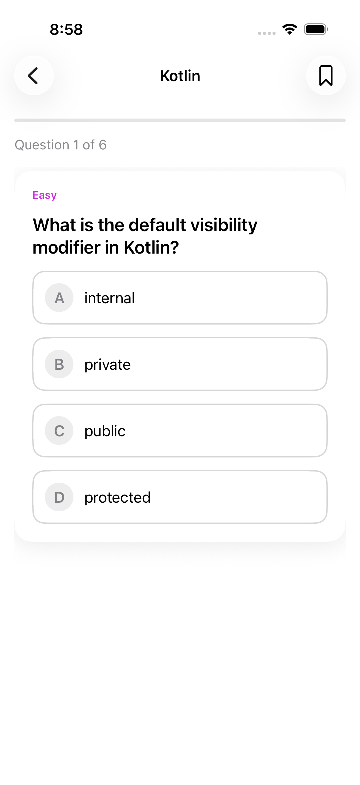
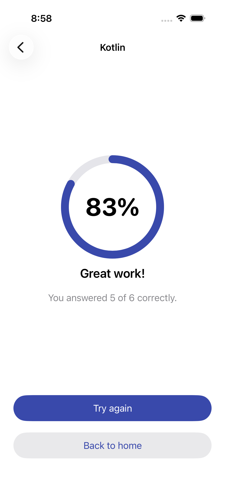
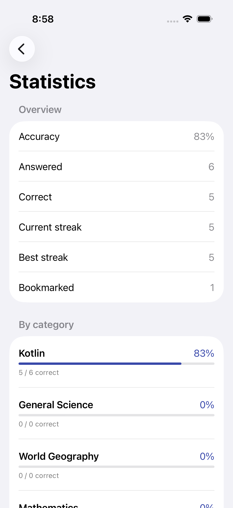
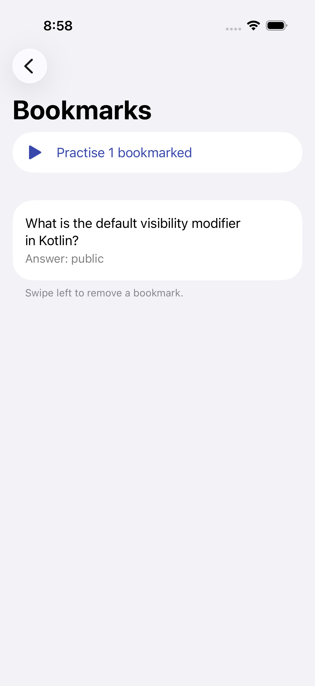

# Question Bank

**Practise anywhere: no account, no sign-up, no internet needed.**

Question Bank is a quiz app for Android and iPhone. Pick a topic, answer questions, see the right
answer explained instantly, and watch your progress grow.

[Download the latest release](../../releases/latest)

---

## Screenshots

### iPhone

  
  
  

  
  
  

## Features

- **Start instantly.** Open the app and you're on the home screen. There's no login and no account.
- **Works offline.** Every question is on your device, so you can practise on a plane or underground.
- **Choose a topic.** Pick a category, or start a quick quiz that mixes questions from every topic.
- **Learn from every answer.** You see straight away whether you were right, which answer was correct, and a short explanation.
- **Feel the result.** A gentle vibration tells you whether an answer was right or wrong.
- **Save questions for later.** Bookmark tricky questions, then practise only your bookmarks.
- **Track your progress.** Accuracy, current and best streaks, and a breakdown for each topic.
- **Light and dark mode.** The app follows your phone's appearance setting.
- **Private by design.** Your answers and progress never leave your phone.

## Topics

| Topic | What's inside |
|---|---|
| Kotlin | Language fundamentals and everyday programming concepts |
| General Science | Physics, chemistry and biology essentials |
| World Geography | Capitals, landmarks and the shape of our planet |
| Mathematics | Arithmetic, geometry and number sense |

More topics and questions are added with each release.

## How to use

1. Open the app.
2. Tap **Start quick quiz**, or choose a topic.
3. Tap an answer. You'll see whether it's right, along with an explanation.
4. Tap **Next question**, or swipe left on iPhone.
5. At the end, see your score and try again or head back home.

**Tips:** Tap the bookmark icon to save a question. On iPhone you can also double-tap a question
card to bookmark it, and swipe left in Bookmarks to remove one.

## Download

Get the newest version from the [Releases](../../releases) page:

- **Android:** download the `.apk` file and open it on your phone.
- **iPhone:** available through the App Store / TestFlight when published.

## Feedback

Found a wrong answer or have an idea for a new topic? [Open an issue](../../issues).

## Author

Created and maintained by **MH TOUFIK** ([@toufikforyou](https://github.com/toufikforyou)).

## License

Released under the [MIT License](LICENSE). © 2026 MH TOUFIK
