<div align="center">


# প্রশ্নব্যাংক · Question Bank

**Every SSC and HSC board question, sorted so you can find it in seconds. No account, no internet.**

প্রশ্নব্যাংক brings past board questions from all education boards of Bangladesh into one app.
Pick an exam, a board and a year, and the full question paper opens. Or study chapter by chapter
and see which questions come back year after year.

[](../../releases/latest)
[](../../actions/workflows/ci.yml)
[](https://kotlinlang.org/docs/multiplatform.html)
[](#build-from-source)
[](#build-from-source)
[](LICENSE)

[**Download the latest release**](../../releases/latest) · [Report a wrong answer](../../issues/new) · [How it's built](#how-its-built)

</div>

---

## Screenshots

### Android

<p align="center">
  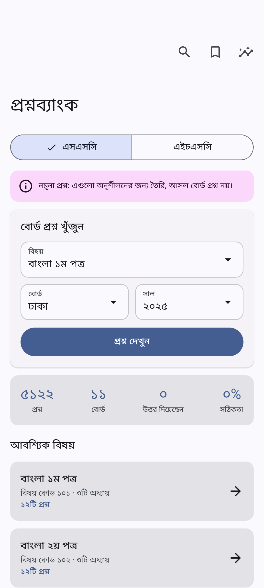
  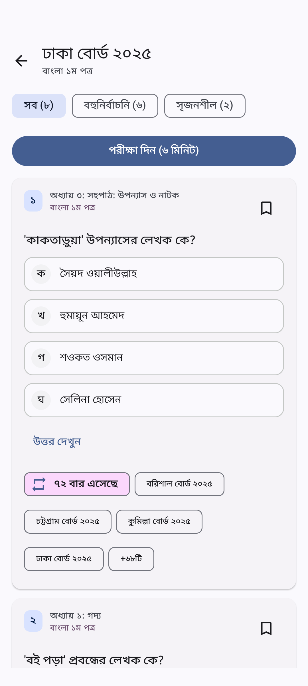
  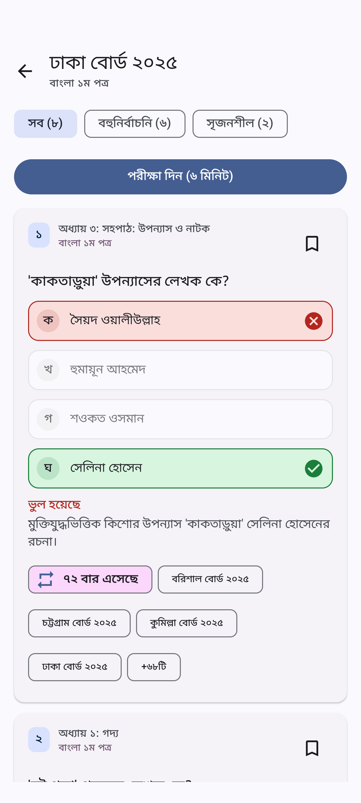
</p>
<p align="center">
  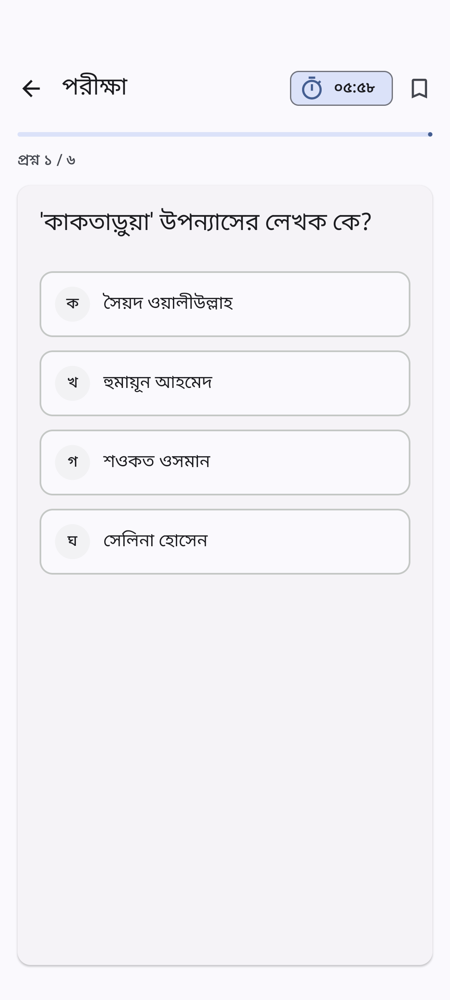
  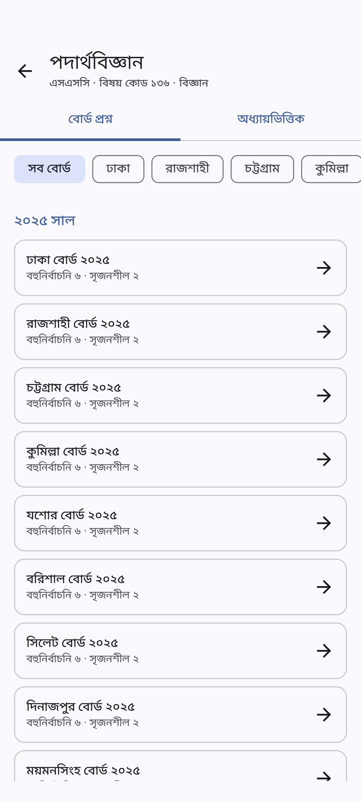
  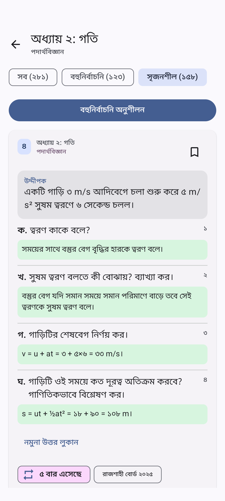
</p>

### iPhone

<p align="center">
  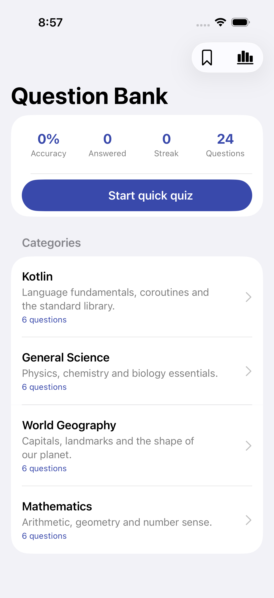
  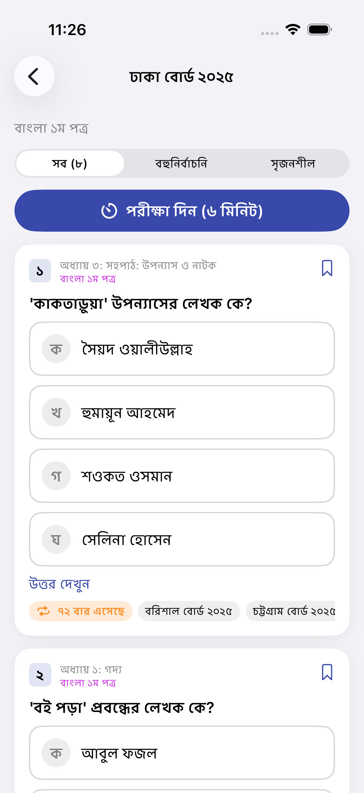
  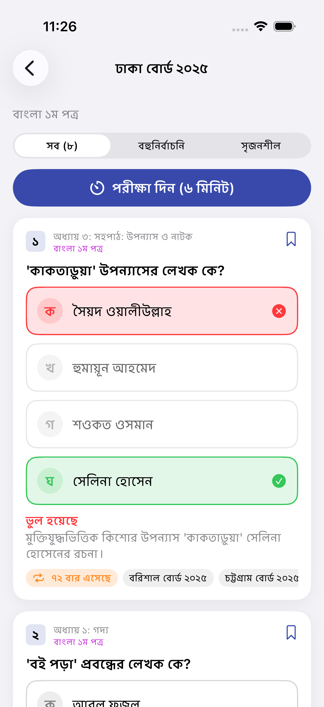
</p>
<p align="center">
  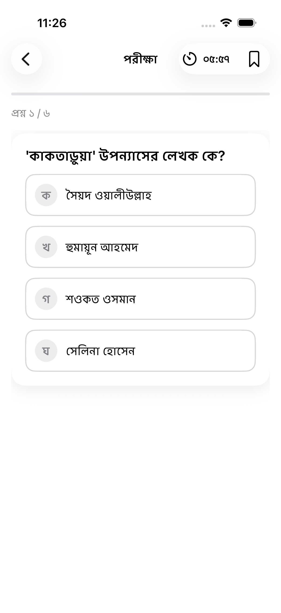
  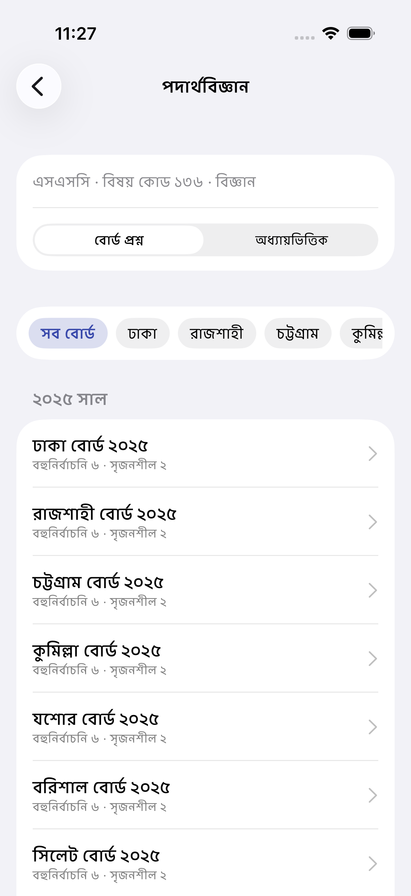
  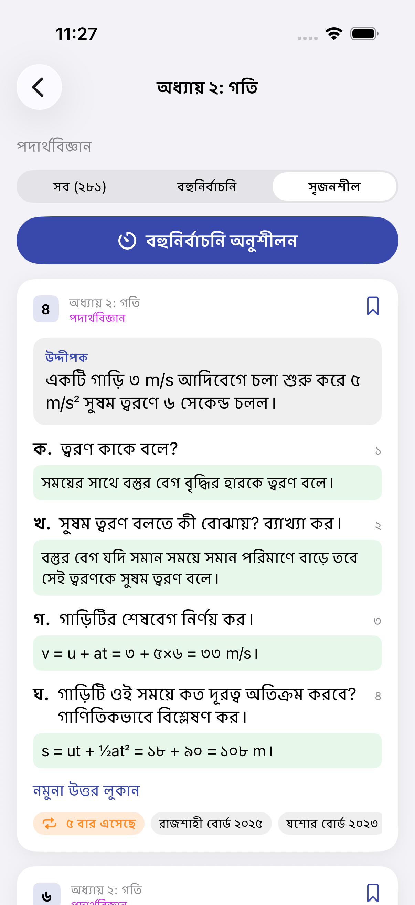
</p>

## What's inside

| | |
|---|---|
| **Exams** | SSC (এসএসসি) and HSC (এইচএসসি) |
| **Boards** | Dhaka, Rajshahi, Chattogram, Cumilla, Jashore, Barishal, Sylhet, Dinajpur, Mymensingh, Madrasah and Technical (all 11) |
| **Years** | 2015 to 2025 |
| **Subjects** | 66 in total: 23 for SSC and 43 for HSC, including 1st and 2nd papers |
| **Groups** | Compulsory, Science, Business Studies, Humanities, and optional/fourth subjects |
| **Question types** | Multiple choice (বহুনির্বাচনি) and creative (সৃজনশীল) with উদ্দীপক and ক/খ/গ/ঘ parts |

**SSC subjects:** Bangla 1st & 2nd, English 1st & 2nd, Mathematics, Bangladesh and Global Studies, ICT,
Islam / Hinduism and Moral Education, Physics, Chemistry, Biology, Higher Mathematics, Accounting,
Finance and Banking, Business Entrepreneurship, Geography and Environment, Economics, Civics and Citizenship,
History of Bangladesh and World Civilization, Science, Agriculture Studies and Home Science.

**HSC subjects (1st & 2nd papers):** Bangla, English, ICT, Physics, Chemistry, Biology, Higher Mathematics,
Accounting, Business Organization and Management, Finance, Banking and Insurance, Production Management and
Marketing, Economics, Civics and Good Governance, History, Islamic History and Culture, Logic, Sociology,
Geography, Social Work, Psychology, Statistics and Agriculture Studies.

The app notes years with no exam or a partial one, such as HSC 2020 and the short-syllabus exams of 2021.

> **Note:** this version ships with sample questions that follow the real board format. They are
> for trying the app and are clearly marked inside it. They are not official board papers.

## Features

- **Find any board paper:** choose a subject, a board and a year, and the full paper opens.
- **Every board and year at a glance:** each subject lists its papers by year, and you can filter by board.
- **Chapter-wise board questions:** see every question from one chapter across all boards and years, with the most repeated first.
- **"Repeated" badge:** shows how many times a question has been set, so you know what's important.
- **Board tags on every question:** for example "ঢাকা বোর্ড ২০২৩, যশোর বোর্ড ২০১৯".
- **Check MCQ answers instantly:** tap an option to see whether it's right, with a short explanation.
- **Model answers for creative questions:** reveal a model answer for each part (ক, খ, গ, ঘ) when you're ready.
- **Exam mode:** sit any board paper's MCQs against the real clock, one minute per question.
- **Practice mode:** random MCQs from a subject, a chapter or your saved questions.
- **Search in Bangla:** type a word such as নিউটন or মূলধন to find questions across every board and year.
- **Bookmarks:** save tricky questions and practise them later.
- **Progress:** accuracy, streaks and results for each subject.
- **Bangla first:** Bangla text and Bangla numerals (২০২৩) throughout.
- **Works offline, no login:** open the app and start. Your progress stays on your phone.
- **Light and dark mode:** follows your phone's setting, with gentle vibration on right and wrong answers.

## How to use

1. Open the app and choose **এসএসসি** or **এইচএসসি**.
2. Under **বোর্ড প্রশ্ন খুঁজুন**, pick a subject, board and year, then tap **প্রশ্ন দেখুন**.
3. Tap an MCQ option to check it, or tap **নমুনা উত্তর দেখুন** on a creative question.
4. Tap **পরীক্ষা দিন** to sit the paper's MCQs as a timed exam.
5. To revise by chapter, open a subject, switch to **অধ্যায়ভিত্তিক** and choose a chapter.

## Download

Get the newest version from the [Releases](../../releases) page:

- **Android:** download the `.apk` file and open it on your phone.
- **iPhone:** available through the App Store / TestFlight when published.

## How it's built

One Kotlin Multiplatform core holds everything the two apps have in common: the question data, search,
exam timing, progress and the screen state. Each platform then draws its own native UI on top, so the
Android app feels like Android and the iPhone app feels like iOS.

```text
┌──────────────────────┐        ┌──────────────────────┐
│   androidApp         │        │   iosApp             │
│   Jetpack Compose    │        │   SwiftUI            │
└──────────┬───────────┘        └──────────┬───────────┘
           │        shared (Kotlin)        │
           └──────────────┬────────────────┘
        presentation  ·  MVI view models and UI state
        domain        ·  models, repository contracts, use cases
        data          ·  SQLDelight database, seed data, cache
```

| Layer | What's in it |
|---|---|
| **Shared** | Kotlin 2.1, Coroutines, kotlinx.serialization, kotlinx-datetime, SQLDelight 2 |
| **Android** | Jetpack Compose, Material 3, Navigation Compose · min SDK 26, target SDK 35 |
| **iOS** | SwiftUI · iOS 16+ · Xcode project generated with XcodeGen |
| **CI** | GitHub Actions runs the shared unit tests and builds both the Android and iOS apps on every push, and captures the screenshots above on a real emulator and simulator |

## Build from source

**You'll need:** JDK 17, Android Studio (latest stable), and for iOS a Mac with the latest stable Xcode and
[XcodeGen](https://github.com/yonaskolb/XcodeGen).

```bash
git clone https://github.com/toufikforyou/question-bank-kmp.git
cd question-bank-kmp

# Android: build a debug APK
./gradlew :androidApp:assembleDebug

# Shared logic: run the unit tests
./gradlew :shared:testDebugUnitTest

# iOS: generate the Xcode project, then open it and press Run
xcodegen generate --spec iosApp/project.yml
open iosApp/iosApp.xcodeproj
```

## Feedback

Spotted a wrong answer, or want a subject added? [Open an issue](../../issues).

## Author

Created and maintained by **MH TOUFIK** ([@toufikforyou](https://github.com/toufikforyou)).

## License

Released under the [MIT License](LICENSE). © 2026 MH TOUFIK
